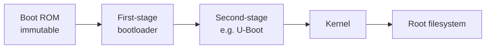

# Chain of Trust and Secure Boot

Secure boot is a chain: each stage verifies the next before running it, anchored in something immutable in silicon. [Bootloader Bypass](bootloader-bypass.md) covers how those chains break in practice; this page is the conceptual map of how they are built, including ARM TrustZone and the eFuse/OTP roots they depend on, so you know what you are attacking.

## The chain, link by link

Each arrow is a cryptographic verification. The root is a **boot ROM** baked into the chip, holding or hashing a public key that lives in one-time-programmable fuses. Because the ROM and fuses cannot be changed, trust extends outward: the ROM verifies stage 1 against the fused key, stage 1 verifies stage 2, and so on. Break or skip any single verification and everything downstream is yours to modify.

## The root of trust: eFuse and OTP

The anchor is a public key (or its hash) and configuration flags stored in **eFuse** or **OTP** (one-time-programmable) memory inside the SoC:

- Blown once at manufacture, not rewritable, so an attacker cannot swap in their own key.
- Also stores feature flags: secure boot enable, debug disable, and sometimes symmetric keys for [flash encryption](../mcu/esp32-security.md).

Attacks on the root itself are advanced and physical:

- **Reading OTP/eFuse** can sometimes be done with invasive techniques (decapping and microscopy, or [fault injection](fault-injection.md) during a fuse read) to recover a symmetric key or a debug-unlock value.
- **Faulting the fuse read** so the chip misreads "secure boot enabled" as disabled is a recurring class of attack on specific silicon.

## ARM TrustZone

TrustZone splits the processor into a **secure world** and a **normal world**, with hardware enforcing that normal-world code cannot touch secure-world memory and peripherals. It is how phones and many SoCs isolate a Trusted Execution Environment (TEE) that holds keys, does DRM, and performs secure boot verification.

For an attacker it means:

- The interesting secrets and the verification logic run in the **secure world**, which you cannot read from the normal world even with root.
- The attack surface is the **boundary**: the calls (SMC, secure monitor calls) the normal world makes into the secure world. Bugs in how the TEE validates those calls are the classic way in, and TEE/TrustZone vulnerabilities have yielded full secure-world compromise on real devices.
- Physically, the secure world runs on the same silicon, so [fault injection](fault-injection.md) and [side-channel](side-channel.md) attacks still reach it.

## Verified boot on application processors

On Linux-class devices the chain often uses:

- **U-Boot with FIT images** and signed configurations, verifying the kernel and device tree.
- **dm-verity** to verify the root filesystem block by block at runtime, so even a mounted rootfs cannot be silently modified.
- A vendor first-stage (Qualcomm, NXP, etc.) rooted in fuses.

Each adds a link, and each is only as strong as its weakest check. The practical failure modes (an unverified stage, an ignored return value, a downgrade, an alternate boot mode) are enumerated on [Bootloader Bypass](bootloader-bypass.md).

## How you actually attack it

1. **Map the chain.** [Extract](firmware-extraction.md) each stage and identify what verifies what, in [Ghidra](../reverse-engineering/ghidra-setup.md).
2. **Find the weak link.** A stage that does not verify the next, a check whose result is discarded, a downgrade path, or a less-strict alternate boot mode.
3. **Attack the root only if you must.** If the software chain is sound, escalate to [glitching](fault-injection.md) a verification or a fuse read, or [side-channel](side-channel.md) recovery of a key.

## Defender's view

Verify every stage over its whole payload and act on the result; anchor in fuses; enable anti-rollback; disable debug and alternate boot modes in production; and make the critical checks [fault-resistant](fault-injection.md#defenders-view). A chain with one unverified link provides no more security than no chain at all.

## Related pages

- [Bootloader Bypass](bootloader-bypass.md)
- [TPM Sniffing](tpm-sniffing.md)
- [Fault Injection and Glitching](fault-injection.md)
- [Side-Channel Attacks](side-channel.md)
- [MCU Targets](../mcu/index.md)
