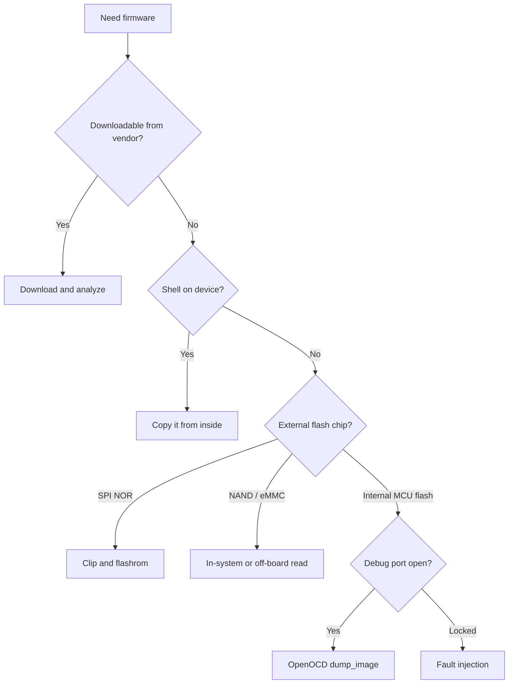

# Firmware Extraction

Getting a copy of the firmware is the pivot of most assessments: once you have the image, analysis happens offline, repeatably, and without risk to the device. There are many routes to a firmware image, and the right one depends on how the device stores its code and how much it cooperates. This page is the decision tree; the detailed procedures live on the linked pages.

## The routes, cheapest first



## 1. Download it

The free route. Vendor support pages, update servers, and community mirrors often host the exact image. Even a partial or older image is worth having: it reveals the layout, the architecture, and frequently the same secrets. Always check this first. See [Reconnaissance](recon.md).

Caveats: downloaded images are sometimes encrypted or packaged in a vendor wrapper, and may differ from what is actually on your unit. Treat a download as a head start, not the final word.

## 2. Copy it from a shell

If you already have interactive access over [UART](../protocols/uart.md), a [bootloader](bootloader-access.md), or the network, pull the firmware from inside the running system. This gives you clean, ECC-corrected data with none of the raw-flash hassle.

```bash
# see the flash partitions
cat /proc/mtd
# dump each MTD partition to a readable place (tftp, nc, usb, sd)
nanddump -o -f /tmp/mtd3.bin /dev/mtd3          # NAND, OOB stripped
dd if=/dev/mtdblock3 of=/tmp/mtd3.bin           # through the block layer
```

Then move the files off the device over the network (`tftp`, `scp`, `nc`), to a USB stick, or to an SD card. Reading from inside is almost always cleaner than reading the raw chip, so prefer it whenever you have any shell. See [Getting a Shell](getting-a-shell.md).

## 3. Dump the external flash directly

No shell, but a readable memory chip on the board. The most common hardware route.

- **SPI NOR (SOIC-8):** clip on and read with [`flashrom`](spi-flash-dump.md). The friendliest case.
- **SPI NAND:** a SPI reader with NAND support, then [reassembly](nand-emmc-dump.md).
- **Parallel NAND (TSOP-48):** usually desolder and read in a programmer, then reassemble. See [NAND and eMMC Dumping](nand-emmc-dump.md).
- **eMMC (BGA):** read in-system through `CLK/CMD/DAT0` or off-board on an adapter. A clean block image. See [eMMC](../protocols/emmc.md).

## 4. Dump internal MCU flash over the debug port

When the firmware lives inside the microcontroller and there is no external chip:

- If [JTAG](../protocols/jtag.md) or [SWD](../protocols/swd.md) is enabled and read-out protection is off, [OpenOCD](../software/openocd.md) reads the internal flash with `dump_image`.
- If read-out protection is set, the debug port refuses, and you escalate to [fault injection](fault-injection.md).

## 5. When the image is encrypted

If the stored image is encrypted (uniform high [entropy](../software/binwalk.md#entropy-analysis-spotting-encryption-and-compression), no signatures), reading the chip gives you ciphertext. Options:

- Find the **decryption routine and key** by analyzing the bootloader, which must decrypt to run.
- **Capture the plaintext in RAM** after the device decrypts it, by halting over JTAG or by [glitching](fault-injection.md) to a state where you can read memory.
- Look for an **update path** or a debug mode that handles plaintext.

## Verify every dump

Whatever the route, prove the copy is faithful before trusting it:

- Read it **two or three times** and compare hashes. See [flashrom](../software/flashrom.md#read-three-times-and-compare).
- Run [`binwalk`](../software/binwalk.md) and sanity-check that the structure matches the boot log's partition layout.
- A dump that fails to carve cleanly often means a bad read, not a clever obfuscation. Re-read before you conclude anything.

With a verified image in hand, move to [Firmware Analysis](firmware-analysis.md).
