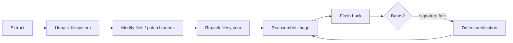

# Firmware Modification

Extraction is only half the loop. Once you understand a firmware image, the natural next step is to change it: patch a binary, flip a configuration flag, add a backdoor shell for testing, and put it back on the device. This page is the logical counterpart to [Firmware Extraction](firmware-extraction.md), covering repacking filesystems, patching binaries, defeating signature checks, and flashing back, on hardware you own.

## The round trip



The difficulty is almost never the editing; it is making the device accept the modified image, which depends on whether and how it verifies firmware.

## Repacking filesystems

Whatever [binwalk](../software/binwalk.md) carved, you usually unpack, edit, and repack the same type.

=== "SquashFS"

    ```bash
    unsquashfs rootfs.squashfs            # -> squashfs-root/
    # edit files in squashfs-root/
    mksquashfs squashfs-root/ new.squashfs -comp xz -b 131072 -noappend
    ```

    **Match the original parameters** (compression algorithm, block size) or the device may reject or fail to mount the image. Read them from the original with `unsquashfs -s rootfs.squashfs`. Vendor-modified SquashFS may need the `sasquatch`/`squashfs-tools-ng` variants.

=== "UBI / UBIFS"

    Rebuild with `mkfs.ubifs` then `ubinize`, matching the original's LEB/PEB sizes and volume layout (from the chip datasheet and the original image). See [UBI and NAND Tools](../software/ubi-nand.md). Getting the geometry right is the whole battle.

=== "JFFS2 / CramFS / ext"

    `mkfs.jffs2` (match erase block size and endianness), `mkcramfs`, or a loop-mounted ext image edited in place and unmounted.

## Reassembling the image

A full flash image is often the bootloader, kernel, and filesystem concatenated at fixed offsets. After repacking one part, place it back at the exact offset the original used (from your [binwalk](../software/binwalk.md) map), preserving sizes and any padding. [`dd`](../software/dd-imaging.md) with the right `seek`/`bs` writes a region into a copy of the original image without disturbing the rest. If a part grew beyond its partition, you must shrink it again, because overrunning into the next partition bricks the device.

## Patching binaries

To change behavior without the source, patch the binary you reversed in [Ghidra](../reverse-engineering/firmware-workflow.md):

- **NOP out a check.** Replace a conditional branch that rejects you with one that always passes (for example turn a "jump if auth failed" into no-op, or invert the condition). You edit the raw bytes at the file offset Ghidra shows.
- **Redirect a call.** Point a function call at a different routine.
- **Flip a constant.** Change a compared magic value, a length, or a flag's default.

Keep patches minimal and the file size identical so offsets elsewhere do not shift. Note the architecture and endianness when assembling replacement instructions.

## Defeating signature verification

If the device verifies the image, a plain repack fails to boot. Options, cheapest first:

1. **Re-sign with a recovered or test key.** If you found the signing/verification key in the [bootloader](../reverse-engineering/firmware-workflow.md) or it uses a test key, sign your modified image legitimately.
2. **Patch out the check.** If the verification runs in a stage you can modify (an earlier unverified bootloader, or the same image where the check is self-referential and weak), NOP the check as above. This is the [bootloader bypass](bootloader-bypass.md) problem.
3. **Target an unverified boundary.** Modify the one stage or partition the chain forgets to verify. See [Chain of Trust](chain-of-trust.md).
4. **Glitch the check at boot.** When the logic is sound and the key is out of reach, [fault injection](fault-injection.md) against the signature comparison lets a modified image run.

## Flashing back

Put the image where it came from:

- **External SPI flash**: [`flashrom -w`](../software/flashrom.md). Keep the original dump as a restore point.
- **From a shell / bootloader**: write the MTD partition with `nandwrite`/`flashcp`, or use [U-Boot](bootloader-access.md) (`sf write`, `nand write`) after loading the image into RAM.
- **eMMC / SD**: [`dd`](../software/dd-imaging.md) the image or partition back.
- **Vendor update mechanism**: sometimes the cleanest path is to feed your image through the device's own update routine, especially if that routine is the weak, unverified link.

!!! danger "Always keep a known-good backup"
    Before writing anything, have a verified copy of the original flash. A bad modification or a wrong offset bricks the device, and the original dump plus a [SPI programmer](spi-flash-dump.md) or [JTAG](../protocols/jtag.md) is how you recover. Two units of a cheap target is cheap insurance.

## Defender's view

The modification loop is exactly what secure boot is meant to stop: verify every stage over its whole payload, act on the result, and make the check [fault-resistant](fault-injection.md#defenders-view). An unverified or weakly verified boot chain means anyone with a flash programmer can run their code on your device.

## Related pages

- [Firmware Extraction](firmware-extraction.md)
- [Firmware Analysis](firmware-analysis.md)
- [Bootloader Bypass](bootloader-bypass.md)
- [Binwalk and Extraction](../software/binwalk.md)
- [UBI and NAND Tools](../software/ubi-nand.md)
