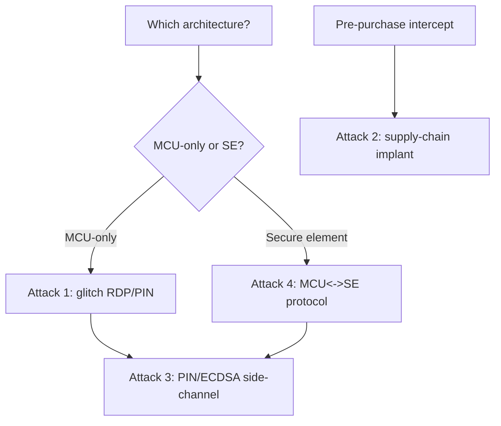

# Hardware Wallet Attacks

A hardware wallet guards a cryptocurrency private key (really a BIP-39 seed) in a small device, signing transactions without exposing the seed to a connected computer. It is a concentrated, high-value [secure-element](secure-elements.md) problem with a public research history, and it is a clean case study in where physical-access attacks succeed and fail. For authorized research on wallets you own.

!!! warning "Authorized use only"
    Extracting someone else's wallet seed is theft. This is for devices you own or research with consent.

## The two architectures

- **General-purpose MCU wallets** (e.g. Trezor-style, STM32-based): the seed lives in the MCU's own flash, protected by a PIN and the MCU's [read-out protection](../mcu/stm32-rdp.md). No dedicated secure element — so the MCU's physical weaknesses are the wallet's weaknesses.
- **Secure-element wallets** (e.g. Ledger-style): the seed lives in a certified [secure element](secure-elements.md) (smartcard-grade), with the MCU acting only as a go-between. The attack surface shifts to the SE's countermeasures and the MCU↔SE protocol.

Identify which you have first; the viable attacks differ completely.

---

## Attack 1 — glitch the PIN/RDP on an MCU wallet

**Target:** MCU-based wallet relying on the MCU's RDP + PIN.
**Gear:** [ChipWhisperer](../software/chipwhisperer.md) or crowbar glitcher.
**Why it works:** if the seed sits in MCU flash behind [RDP](../mcu/stm32-rdp.md), the same [fault-injection](fault-injection.md) that defeats that MCU's read protection dumps the seed. Published Trezor One research used a voltage glitch during the firmware's flash-protection setup to downgrade protection and read out the seed; the fix combined firmware changes and moving secrets behind a PIN-derived key.

Steps: identify the MCU, follow the [STM32 RDP](../mcu/stm32-rdp.md) / [glitch loop](fault-injection.md#the-workflow) for that part, trigger on the protection-check window, dump flash, extract the BIP-39 seed from the image.
**Mitigation:** store the seed encrypted under a PIN-derived key (so a flash dump is useless without the PIN), add glitch-resistant redundant checks, or use a secure element.

## Attack 2 — supply-chain / tamper implant

**Target:** a wallet intercepted before it reaches the user.
**Idea:** modify firmware or add an implant that later leaks the seed or swaps the receive address (the Kraken/Ledger teardown research and the "evil maid" class). Also includes shipping a **pre-seeded** device with a known recovery phrase and scratch-off sticker forgery.
**Mitigation:** genuine-device attestation, tamper-evident packaging, and on-device verification that the user generates a fresh seed.

## Attack 3 — side-channel the PIN or signing

**Target:** both architectures, PIN verification and ECDSA signing.
**Idea:** [power/EM analysis](side-channel.md) of PIN comparison (leaks whether each digit matched → reduces brute force) or of the ECDSA nonce (leaks bits → lattice recovery of the key, the [Minerva class](side-channel.md#named-remote-and-timing-variants)). Published PIN side-channels have cut the guessing space on some wallets dramatically.
**Mitigation:** constant-time PIN compare with a hardware retry counter, masked/constant-time ECDSA, SE-held PIN.

## Attack 4 — attack the MCU↔SE protocol (SE wallets)

**Target:** secure-element wallets.
**Idea:** the SE is hard, so look at how the MCU uses it — does the MCU enforce the PIN, or the SE? Can the MCU be convinced the SE approved when it did not ([the same host-decision bypass](secure-elements.md#attack-1-bypassreplay-the-host-side-decision-usually-the-weak-link))? Does an unencrypted MCU↔SE link leak material? The system around the SE is usually weaker than the SE.
**Mitigation:** let the SE (not the MCU) hold the PIN and the seed and make every security decision; encrypt and authenticate the MCU↔SE channel.

## Decision flow

## Defender's view

Keep the seed in a certified [secure element](secure-elements.md), encrypt it under a PIN-derived key with a hardware-enforced retry counter and wipe, make the SE (not the MCU) the arbiter of every decision, use constant-time/masked crypto and PIN checks, and ship tamper-evidence plus genuineness attestation so interception is detectable. Assume a determined attacker with physical possession and a glitch rig; design so that possession alone does not yield the seed.

## Related pages

- [Secure Elements](secure-elements.md)
- [Fault Injection and Glitching](fault-injection.md)
- [STM32 RDP](../mcu/stm32-rdp.md)
- [Side-Channel Attacks](side-channel.md)
- [Decapping and Invasive Attacks](decapping.md)
