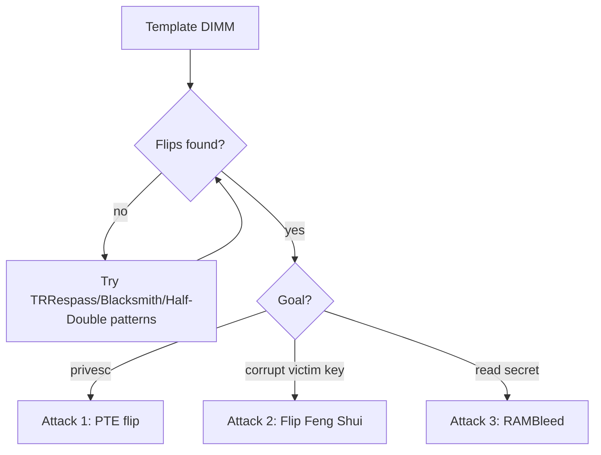

# Rowhammer

Rowhammer is a DRAM disturbance effect with security consequences: repeatedly accessing one memory row leaks charge in physically adjacent rows, flipping bits the attacker never had permission to write. Because it corrupts memory the CPU's privilege model says is off-limits, a pure-software process can flip bits in page tables, keys, or sandbox state and escalate. It bridges hardware (the physics of shrinking DRAM cells) and software exploitation.

!!! warning "Authorized use only"
    For research on systems you own or are authorized to test.

## Why it works

DRAM stores each bit as charge in a capacitor packed ever more densely. Activating a row couples tiny disturbances into neighbors; enough activations within one refresh interval (~64 ms) before the victim row is refreshed, and a neighbor cell flips. The attacker needs no write access to the victim row — only to **hammer** rows next to it.

Two access patterns:

- **Double-sided:** hammer the two rows bracketing the victim (rows N-1 and N+1 to flip in N). Most effective.
- **Single-sided / one-location:** hammer accessible rows and hope to land near a target; needed when you cannot place rows precisely.

The hard part is defeating caching (hammered accesses must reach DRAM, not the cache) and knowing the DRAM row mapping.

## Step 0 — profile the DIMM

```bash
# find vulnerable bit-flip offsets on the machine's own memory
git clone https://github.com/google/rowhammer-test   # classic PoC
# or use the memory-templating phase of a framework (see below)
```

Templating hammers memory and records which physical offsets flip and in which direction (1→0 or 0→1). No flips found on a given module → that DIMM resists this pattern; try another pattern (below) before concluding immune.

---

## Attack 1 — page-table escalation (classic privilege escalation)

**Target:** a Linux host with hammerable DRAM.
**Why it works:** flip a bit in a page-table entry so a page you own now maps to a page table itself, giving you write access to your own address translation → full physical memory.

Steps:

1. **Template** memory to find a reliable flip at a known offset/direction.
2. **Groom** physical memory (spray page tables) so a page-table entry lands on the vulnerable cell — `/proc/self/pagemap`-style tricks or exhaustion.
3. **Hammer** to flip that PTE bit; your virtual page now points into a page table.
4. **Rewrite** your translations and read/write arbitrary physical memory → root.

This is the original Project Zero result (`exploit` in the seaborn/dullien work).
**Success condition:** a controlled PTE bit flips and you gain kernel-level memory access.

## Attack 2 — cross-VM / cross-process key and data corruption

**Target:** co-located VMs or processes on shared DRAM.
**Variants:** **Flip Feng Shui** places a victim's page (e.g. an RSA public key in an APT repo file, or an authorized_keys file) on a vulnerable cell via memory dedup (KSM), then flips a bit to weaken the key so the attacker can factor it or inject trust.
**Steps:** force dedup to share the target page onto a known-vulnerable location, hammer, flip a bit in the victim's key/data.

## Attack 3 — RAMBleed (read, not just write)

**Target:** secrets in other processes' memory.
**Idea:** the *direction* a victim cell flips depends on the data in neighboring rows, so Rowhammer leaks information — RAMBleed reads bits of a victim's memory (demonstrated recovering an OpenSSH RSA key) rather than only corrupting.

## Attack 4 — defeat mitigations (modern DRAM)

DDR4/LPDDR4 added **Target Row Refresh (TRR)** in the chip. Published work shows it is bypassable:

- **TRRespass:** many-sided hammering (hammer many aggressor rows) overwhelms TRR's limited tracking.
- **Half-Double:** exploits that hammering row N also weakly disturbs row N±2, chaining past TRR.
- **Blacksmith:** non-uniform, frequency-domain hammering patterns that evade TRR on most tested DDR4.
- **ECCploit:** ECC memory corrects single-bit flips but Rowhammer can produce multi-bit patterns that slip past ECC; ECC raises the bar, it is not immunity.

Use these patterns in the templating phase when simple double-sided hammering finds no flips.

## Decision flow



## Defender's view

Rowhammer is a hardware defect, so software mitigations are partial: use **ECC DRAM** (raises cost, not immune — ECCploit), prefer modules with strong in-DRAM TRR but do not trust it alone, **increase refresh rate** (double-refresh in firmware) where supported, disable **memory deduplication (KSM)** on multi-tenant hosts to kill Flip Feng Shui, and isolate tenants to separate DRAM where the threat model is cross-VM. The real fix is in the silicon (DDR5 improvements, on-die mitigation), so track the DRAM generation in your threat model.

## Related pages

- [Memory Types](../fundamentals/memory-types.md)
- [Cold Boot Attacks](cold-boot.md)
- [DMA Attacks](dma-attacks.md)
- [Transient Execution](transient-execution.md)
- [Side-Channel Attacks](side-channel.md)
