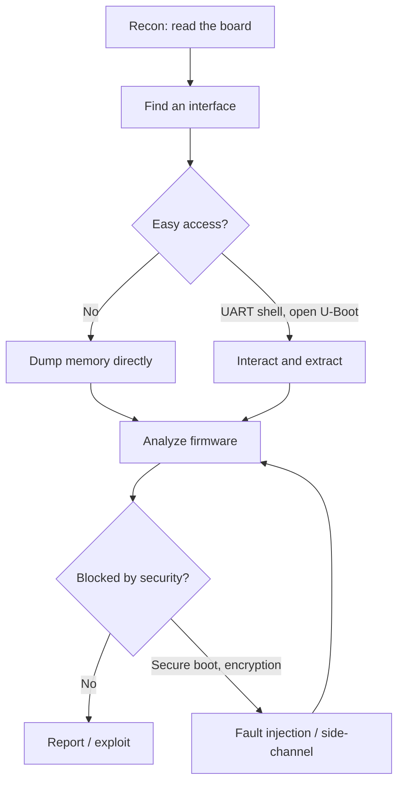

# Methodology

A device you have never seen can feel like a wall with no door. The way through is a loop that you repeat at increasing cost and invasiveness, stopping the moment a cheaper step gives you what you need. This page is that loop. Every other section of the wiki is a detail of one of these stages.

## The loop

## Stage 1: Reconnaissance

Learn the device before you touch it. Open the case, photograph both sides of the board, and read every chip marking. Identify the main processor, the memory chips, and any radios. Pull the datasheets. Look up the FCC ID for internal photos and sometimes a full schematic. The goal of this stage is a mental map: what runs the code, where the code is stored, and what interfaces exist.

Full detail: [Reconnaissance](../attacks/recon.md) and [PCB Recon](../fundamentals/pcb-recon.md).

## Stage 2: Find an interface

Every later step needs a way in. In rough order of effort:

1. **Serial console (UART).** Look for a 3 or 4 pin header or a row of test pads near the SoC. This is the first thing to check because it so often yields a shell or at least a verbose boot log. See [Finding and Identifying Pins](../fundamentals/identifying-pins.md).
2. **External memory chip.** A SOIC-8 SPI flash is a standing invitation to clip on and read the firmware with no cooperation from the CPU.
3. **Debug port (JTAG/SWD).** More powerful and more work. Lets you halt the CPU and read all memory, including internal flash.
4. **Inter-chip buses (I2C/SPI).** Sniff them to catch EEPROM contents or secrets moving between parts.

## Stage 3: Get in or get the data

Two broad paths, often pursued in parallel:

- **Interactive access.** Drop to a shell over [UART](../protocols/uart.md), [interrupt the bootloader](../attacks/bootloader-access.md) to get a U-Boot prompt, or halt the CPU over [JTAG](../protocols/jtag.md). This gives you a live system to explore.
- **Static extraction.** [Dump the SPI flash](../attacks/spi-flash-dump.md) or [NAND/eMMC](../attacks/nand-emmc-dump.md) to get the firmware without a running shell. This works even when every interactive path is locked.

## Stage 4: Analyze

Carve the dumped image with [binwalk](../software/binwalk.md), rebuild the filesystems, and start reading. Look for:

- Hardcoded credentials, keys, and certificates.
- The web server and its CGI handlers (a classic source of command injection).
- Startup scripts that reveal how the device boots and what it trusts.
- Update mechanisms and how they verify (or fail to verify) new firmware.

Load interesting binaries into [Ghidra](../reverse-engineering/ghidra-setup.md) with the right architecture settings.

## Stage 5: Escalate only when blocked

If the firmware is encrypted, the boot chain is verified, or a lock bit prevents read-out, the software paths are exhausted and you move to physical attacks:

- **[Fault injection](../attacks/fault-injection.md)** to skip a signature check or defeat read protection.
- **[Side-channel analysis](../attacks/side-channel.md)** to recover a key the device refuses to reveal.

These are powerful and slow. They are a last resort, not a first move.

## Principles that hold across every target

- **Cheapest step first.** Check for an open UART shell before you reach for a glitcher.
- **Non-invasive before invasive.** Clip onto a chip before you desolder it. Desolder before you decap.
- **Change one thing at a time.** When a capture is wrong or a device misbehaves, isolate the variable.
- **Common ground, correct voltage, always.** The two mistakes that destroy the most hardware. See [Lab Setup](lab-setup.md).
- **Write it down.** Your notebook is part of the toolkit. See [Lab Setup](lab-setup.md#keep-a-lab-notebook).
- **Expect to brick things.** Buy two of a cheap target when you can. The second unit is your reference for voltages and pinouts after you break the first.
