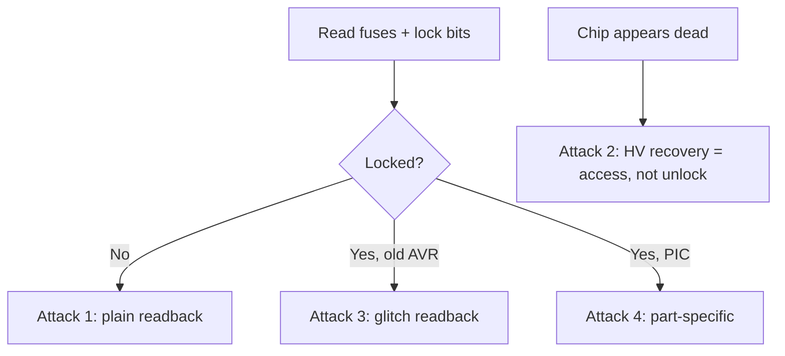

# AVR and PIC Fuses

The classic 8-bit microcontrollers — Microchip's AVR (the ATmega/ATtiny behind Arduino) and PIC families — protect firmware with **lock bits** and configure behavior with **fuses**. Simpler than the Cortex-M protections, but the same questions apply: what does the lock block, and can it be bypassed.

!!! warning "Authorized use only"
    For devices you own or are authorized to assess.

## Fuses versus lock bits

- **Fuses** configure the chip: clock source, brown-out, reset-pin behavior, bootloader size. Not primarily a security feature, but one wrong write can brick reprogramming (see Attack 2).
- **Lock bits** are the security feature: whether flash and EEPROM can be read back or reprogrammed through the programming interface.

### AVR lock bits

| Mode | Effect |
| --- | --- |
| No lock | Flash and EEPROM read/write freely via ISP/SPI. |
| LB1 programmed | Further programming disabled. |
| LB1+LB2 programmed | Programming **and verification (readback) disabled** — firmware protected from a simple read. |

**A chip erase clears the lock bits but also erases flash**, so you cannot unlock-then-read the easy way (same dilemma as [STM32 RDP1](stm32-rdp.md)).

### PIC code protection

PIC devices have an analogous **CP (Code Protection)** bit in their config words. Set = programmer cannot read program memory back. Bulk erase clears protection but wipes the code.

## Step 0 — read fuses and lock bits

```bash
# AVR via USBasp: read low/high/ext fuses and lock byte as hex
avrdude -c usbasp -p m328p -U lfuse:r:-:h -U hfuse:r:-:h -U efuse:r:-:h -U lock:r:-:h
```

A lock byte with LB1+LB2 set (e.g. `0xFC` on an m328p) means readback is blocked. For PIC, read the config words with MPLAB / `pk2cmd` / pickit tooling.

---

## Attack 1 — plain readback (unlocked)

**Target:** parts with lock bits clear (most hobby and many commercial devices).

```bash
avrdude -c usbasp -p m328p -U flash:r:flash.bin:r -U eeprom:r:eeprom.bin:r
```

**Success condition:** `flash.bin` disassembles (`avr-objdump -D -m avr5 flash.bin`) into sane AVR code.
**Mitigation:** set LB1+LB2 (AVR) / CP (PIC).

---

## Attack 2 — high-voltage recovery of a fuse-bricked part

**Target:** a chip that appears dead because of a bad fuse write, not a security lock.
**Why it works:** HVPP/HVSP does not depend on the configured clock or the SPIEN/RSTDISBL fuses that ISP needs, so it revives parts ISP cannot reach. Note: HV programming can read/rewrite fuses but **does not bypass readback lock bits** without erasing — this recovers access, it does not defeat protection.

Common bricks and the fix:

- **Clock fuse set to absent external crystal/clock** → feed an external clock into XTAL1, or use HVPP/HVSP.
- **RSTDISBL (reset pin as GPIO) or SPIEN cleared** → ISP is locked out; HV programming is the only route.

Gear: a high-voltage programmer (STK500, or a dedicated HVPP/HVSP fuse-rescuer board). Reset the offending fuse to a sane value, then ISP works again.

---

## Attack 3 — fault-injection readback on locked AVR

**Target:** older AVRs with LB1+LB2 set, which were not designed for glitch resistance.
**Precondition:** controllable reset/clock + core-rail access.
**Gear:** [ChipWhisperer](../software/chipwhisperer.md) or crowbar glitcher driving the ISP read.
**Why it works:** the lock-bit check gating a readback is a decision point; a timed fault during the check (or during the per-byte readback verification) can let protected bytes out one at a time.

Steps (standard [glitch loop](../attacks/fault-injection.md#the-workflow)):

1. Script an ISP readback transaction and trigger the glitch on the lock-bit-check phase.
2. Sweep `ext_offset` × `width`; for clock-glitch-capable parts also try clock glitching.
3. Success detector: a read byte comes back as real flash content instead of the protected/garbage value.
4. Harvest byte-by-byte across the address space and stitch.

**Success condition:** reconstructed image disassembles cleanly.
**Mitigation:** prefer a modern MCU with hardened protection; legacy lock bits are not glitch-proof.

---

## Attack 4 — PIC code-protection extraction

**Target:** specific PIC families/devices with published readback or glitch techniques.
**Note:** highly part-specific — some older PICs have documented ICSP readback quirks or glitch windows; identify the exact device and check current research before investing time. Where no technique exists, bulk erase only wipes the code.

**Mitigation:** CP set on a current device family.

## Decision flow



## Defender's view

Set the readback lock bits (LB1+LB2 on AVR, CP on PIC), but know that on older 8-bit parts this is not glitch-proof. For firmware that must stay secret on a hostile-access device, prefer a modern MCU with hardened protection over legacy lock bits alone. See the [fault injection defender notes](../attacks/fault-injection.md#defenders-view).

## Related pages

- [MCU Targets](index.md)
- [STM32 RDP](stm32-rdp.md)
- [Fault Injection and Glitching](../attacks/fault-injection.md)
- [CPU Architectures](../fundamentals/architectures.md)
- [Memory Types](../fundamentals/memory-types.md)
