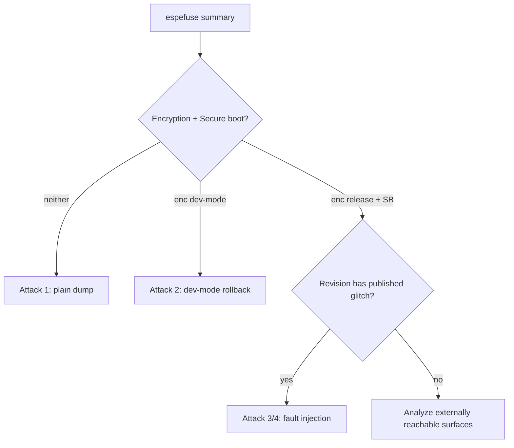

# ESP32 Security

Espressif's ESP32 and ESP8266 are everywhere in cheap Wi-Fi and Bluetooth devices. Unlike [STM32](stm32-rdp.md) or [nRF52](nrf52-approtect.md), the classic ESP32 stores its firmware in an **external** SPI flash, so the default situation is wide open. The security story is two optional eFuse features — **flash encryption** and **secure boot** — and what they do and do not stop.

!!! warning "Authorized use only"
    For devices you own or are authorized to assess. Burning eFuses is one-time and irreversible.

## Step 0 — read the eFuse state

Everything branches on what is actually enabled, and most devices enable nothing.

```bash
espefuse.py --port /dev/ttyUSB0 summary
```

Look for: `FLASH_CRYPT_CNT` (flash encryption on/off and dev vs release), `ABS_DONE_0`/`ABS_DONE_1` or `SECURE_BOOT_EN` (secure boot v1/v2), `UART_DOWNLOAD_DIS`, `DISABLE_DL_ENCRYPT`, and the chip **revision** (`espefuse.py summary` header, or `esptool.py chip_id`). The exact attack depends on the variant (ESP32, ESP32-S2/S3, ESP32-C3) and revision, so record them.

---

## Attack 1 — plain external-flash dump (default devices)

**Target:** stock ESP32 with no protections (the common case).
**Gear:** USB-UART adapter, or a [SOIC-8 clip + flashrom](../software/flashrom.md).

In-circuit over the ROM UART bootloader:

```bash
# hold GPIO0 low at reset to enter download mode, then:
esptool.py --port /dev/ttyUSB0 --baud 921600 read_flash 0x0 0x400000 flash.bin
```

Or clip the external [SPI flash](../protocols/spi.md) and read it directly:

```bash
flashrom -p ch341a_spi -r flash.bin
```

**Success condition:** `binwalk flash.bin` shows the partition table at `0x8000` and an `app` partition; [esptool image_info](../software/esptool.md) parses the app header.
**Mitigation:** enable flash encryption *and* secure boot (below).

---

## Attack 2 — development-mode flash-encryption rollback

**Target:** devices left in **development-mode** flash encryption (very common; the mode exists to allow re-flashing).
**Why it works:** dev mode leaves the download-mode encryption/decryption path usable and `FLASH_CRYPT_CNT` re-writable, so you can re-flash and read plaintext through the bootloader, unlike release mode.

Steps:

1. Confirm dev mode in `espefuse.py summary` (`FLASH_CRYPT_CNT` odd/low count, `DISABLE_DL_DECRYPT` **not** burned).
2. Use the download-mode decrypt path to read decrypted contents, or re-flash a known plaintext and compare:
   ```bash
   # dev mode: bootloader will transparently handle the encrypted read/write path
   esptool.py --port /dev/ttyUSB0 read_flash 0x0 0x400000 enc.bin
   ```
3. If the key can still be used in download mode, the external dump is effectively recoverable.

**Success condition:** decrypted app image parses.
**Mitigation:** release mode only; burn `DISABLE_DL_ENCRYPT` / `DISABLE_DL_DECRYPT` / `DISABLE_DL_CACHE`.

---

## Attack 3 — fault-injection secure-boot bypass

**Target:** specific ESP32 revisions with documented glitch bypasses of secure boot (Raelize / LimitedResults ESP32 research; see also CVE-2019-15894 class fault-injection flaws).
**Precondition:** controllable reset, core-rail access.
**Gear:** [ChipWhisperer](../software/chipwhisperer.md) or custom crowbar + the UART bootloader.
**Why it works:** the ROM/bootloader signature check and the download-mode gate are single decision points; a timed fault during the check can let unsigned firmware run or re-open download mode on a locked part.

Steps (standard [glitch loop](../attacks/fault-injection.md#the-workflow)):

1. Trigger on reset release / bootloader entry.
2. Sweep `ext_offset` across the verification window × `width`.
3. Success detector: the part accepts an unsigned image / drops back into download mode / enables cache so plaintext is reachable.
4. Once in, dump or run a stub.

**Success condition:** unsigned stub executes, or download mode returns on a part that had it disabled.
**Mitigation:** current revision with the fix; defense-in-depth per [chain of trust](../attacks/chain-of-trust.md).

---

## Attack 4 — glitch the flash-encryption / download path

**Target:** revisions where a fault during the encryption-flow enforcement exposes plaintext or the key path.
**Gear:** glitcher + UART.
**Idea:** glitch the bootloader so `DISABLE_DL_DECRYPT`/cache gating is bypassed, then use the download-mode decrypt path (as in Attack 2) on a part that was supposed to be in release mode. Highly revision-specific — verify against current research for the exact die.

**Mitigation:** release-mode encryption on a fixed revision; burn all download-mode disable fuses.

---

## Newer RISC-V parts

The ESP32-C series (RISC-V) changed the [architecture](../fundamentals/architectures.md#espressif-a-common-special-case) and the security implementation; treat them separately from the original Xtensa ESP32 and re-check which attacks apply.

## Decision flow



## Defender's view

Enable **both** flash encryption (release mode, not development) **and** secure boot v2, on a current chip revision, and burn the download-mode disable fuses. Encryption alone leaves code-execution open; secure boot alone leaves secrets in plaintext flash. Verify the eFuse state on production units rather than trusting that the build config took effect.

## Related pages

- [MCU Targets](index.md)
- [SPI Flash Dumping](../attacks/spi-flash-dump.md)
- [esptool](../software/esptool.md)
- [Fault Injection and Glitching](../attacks/fault-injection.md)
- [Chain of Trust and Secure Boot](../attacks/chain-of-trust.md)
