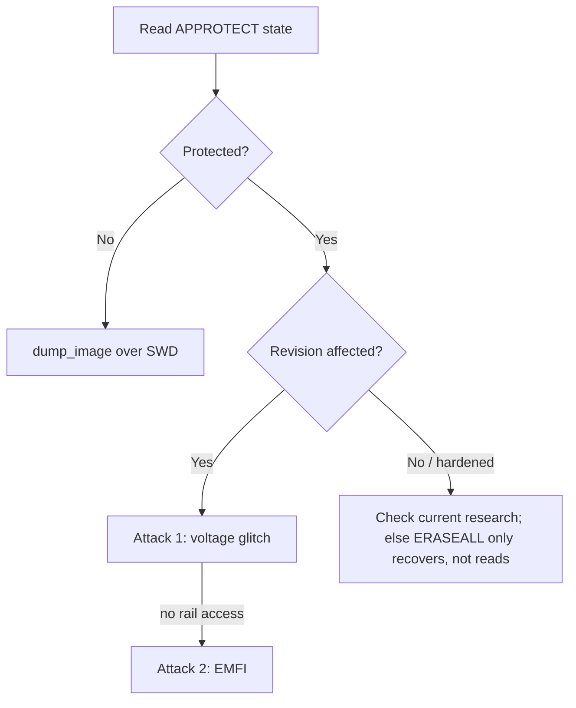

# nRF52 APPROTECT

Nordic's nRF52 series powers a huge number of Bluetooth Low Energy devices: wearables, locks, beacons, medical gadgets. Its firmware protection is **APPROTECT** (access port protection), and it is the textbook example of a read-out protection defeated by a single, cheap, well-timed glitch (LimitedResults, "nRF52 Debug Resurrection", 2020).

!!! warning "Authorized use only"
    For devices you own or are authorized to assess.

## What APPROTECT does

When enabled, the nRF52 disables the debug access port, so [SWD](../protocols/swd.md) cannot read internal flash — same deal as [STM32 RDP](stm32-rdp.md) on the surface. The weakness is enforcement: on original silicon the boot ROM copies the APPROTECT value out of the UICR flash register into a peripheral register early in boot, and *only then* is the debug port gated. That copy-and-enforce step happens at a predictable moment after reset and is a single point of failure.

## Step 0 — identify part, revision, and protection state

The outcome depends entirely on the chip revision, so read it first.

```bash
# Try to connect; a protected part exposes only CTRL-AP, not the AHB-AP
openocd -f interface/cmsis-dap.cfg -f target/nrf52.cfg -c "init; dap info; shutdown"

# nrfjprog: read the die/variant and APPROTECT state
nrfjprog --readregs
nrfjprog --memrd 0x10001208 --n 4   # UICR.APPROTECT (0xFFFFFFFF = protected on newer)
```

- **Unprotected:** AHB-AP enumerates, `dump_image fw.bin 0x0 0x80000` works — just read it.
- **Protected:** only the CTRL-AP is visible; AHB-AP reads fail. This is the state you attack.

!!! note "Do not ERASEALL"
    The CTRL-AP offers a `RECOVER`/`ERASEALL` that unlocks debug **by wiping flash**. It recovers a bricked dev board; it destroys the firmware you came to read. Same dilemma as STM32 RDP1.

---

## Attack 1 — single voltage-glitch APPROTECT bypass

**Target:** affected (older) nRF52832 / nRF52840 revisions.
**Precondition:** controllable reset; access to decoupling cap / core rail for a [crowbar glitch](../attacks/fault-injection.md#building-a-crowbar-glitcher).
**Gear:** [ChipWhisperer](../software/chipwhisperer.md), or a modest custom glitcher + SWD probe.
**Difficulty:** low — the vulnerable write is a single op in a narrow, repeatable window, so the parameter search is small and hit rate high.

Steps:

1. **Prep SWD:** wire SWDIO/SWDCLK/GND/reset. Keep a probe attached to poll the AHB-AP.
2. **Find the decoupling cap on the core voltage (DEC pins / VDD)** and connect the crowbar MOSFET across it; or cut and inject.
3. **Trigger on reset release.** The enforcement happens microseconds after reset.
4. **Sweep** `ext_offset` across the early-boot window and `width` small:
   ```python
   for off in range(off_lo, off_hi):      # scan the post-reset us window
       for width in range(w_lo, w_hi):
           scope.glitch.ext_offset = off
           scope.glitch.width = width
           reset_target()
           scope.arm(); release_reset(); scope.capture()
           if ahb_ap_now_enumerates():   # AHB-AP appeared = APPROTECT faulted off
               dump_flash("fw.bin", 0x0, 0x80000)
               break
   ```
5. **On success the AHB-AP comes alive** — dump flash immediately over SWD before the next reset.

**Success condition:** `dump_image` returns a valid Cortex-M vector table (SP then reset handler into `0x0000xxxx`).
**Mitigation:** current silicon revision with hardened APPROTECT.

---

## Attack 2 — EMFI variant (contactless, cheap)

**Target:** same affected revisions when you cannot cleanly reach the core rail.
**Gear:** [PicoEMP](../attacks/fault-injection.md#cheap-emfi-picoemp) or a commercial EM pulser, XYZ stage, SWD probe.

Steps:

1. Decap-free: position the EM probe over the die (package top), small coil.
2. Trigger on reset release as in Attack 1.
3. Sweep **probe XY position** (coarse grid over the die) × `ext_offset` × pulse strength.
4. Poll the AHB-AP after each pulse; on enumeration, dump.

EMFI trades the rail connection for a spatial search dimension; otherwise the loop and success condition are identical to Attack 1.

**Mitigation:** hardened revision; shielding alone is not sufficient.

---

## Hardware revisions matter

Nordic hardened **APPROTECT** (and added `SECUREAPPROTECT` on nRF5340 / nRF91) in newer silicon so enforcement is not a single glitchable write. So:

- **Older/affected nRF52 revisions:** Attacks 1–2 apply, usually quickly.
- **Newer revisions:** the simple single-glitch is mitigated; expect far more effort and check current research for that exact part and date code.

Identify the precise variant and revision during [recon](../attacks/recon.md) before assuming either result.

## Decision flow



## Defender's view

Use a current silicon revision with hardened protection; do not rely on original APPROTECT alone. The general lesson: any protection enforced by a single instruction or register write is a glitch target, so make enforcement redundant and re-check it after boot. See the [fault injection defender notes](../attacks/fault-injection.md#defenders-view).

## Related pages

- [MCU Targets](index.md)
- [STM32 RDP](stm32-rdp.md)
- [Fault Injection and Glitching](../attacks/fault-injection.md)
- [SWD](../protocols/swd.md)
- [RF Attacks](../radio/rf-attacks.md)
