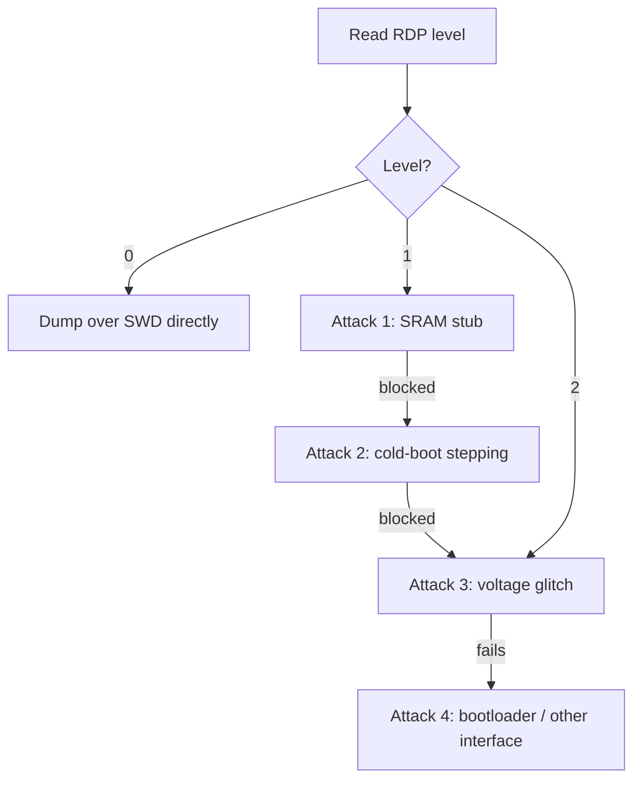

# STM32 RDP

STM32 is the most common Cortex-M family you will meet, and its firmware protection is **RDP** (Readout Protection), stored in an option byte. Understanding its three levels, and the published attacks that defeat level 1, is a standard part of assessing an STM32-based device.

!!! warning "Authorized use only"
    Everything below is for assessing devices you own or are authorized to test. Glitching and debug-exfiltration are destructive-capable and void warranties.

## The three RDP levels

| Level | Value | Effect |
| --- | --- | --- |
| **0** | `0xAA` | No protection. Debug reads flash freely. |
| **1** | anything except `0xAA`/`0xCC` | Debug blocked from flash/SRAM, but **dropping to level 0 triggers a mass erase**. User code still runs and can access flash. |
| **2** | `0xCC` | Debug port permanently disabled. No going back. |

The interesting state is **level 1**: the debugger is blocked from reading flash, but the escape hatch (lower to 0) wipes the chip, so you cannot just reset protection to read code. The firmware itself still reads its own flash normally — that asymmetry is what every level-1 attack exploits. **Level 2** truly closes the debug port; the only routes left are glitching the option-byte load or non-debug interfaces.

## Step 0 — identify and read protection state

Specific glitch parameters and known bypasses are series-dependent, so pin down the exact part (series + revision) during [recon](../attacks/recon.md) first.

```bash
# OpenOCD: connect under reset so locked parts still attach
openocd -f interface/stlink.cfg -f target/stm32f1x.cfg \
        -c "init; reset halt; mdw 0x40022000 0"   # read FLASH_ACR etc.

# Read the option bytes / RDP level (F1 example: FLASH_OBR at 0x4002201C)
openocd -f interface/stlink.cfg -f target/stm32f1x.cfg \
        -c "init; mdw 0x4002201C 1; shutdown"
```

- **Level 0:** `flash read_bank 0 dump.bin 0 0x20000` succeeds.
- **Level 1:** a flash read over SWD returns all `0x00` or errors while the chip clearly runs. This is the shipping state you attack.
- **Level 2:** the debug probe cannot connect at all.

---

## Attack 1 — SRAM-stub flash dump (no glitch)

**Target:** STM32F1 (and similar) at **RDP level 1**, where debug can still access SRAM and run code there.
**Precondition:** SWD reachable; SRAM debug-accessible; CPU flash read not itself gated.
**Gear:** ST-Link + OpenOCD only. No glitching.
**Why it works:** RDP1 blocks *debug* reads of flash, not the *CPU's* reads. Load a tiny copy loop into SRAM over debug, run it so the CPU copies flash into SRAM, then read SRAM over debug.

Steps:

1. Connect and halt:
   ```bash
   openocd -f interface/stlink.cfg -f target/stm32f1x.cfg -c "init; reset halt"
   ```
2. Write a copy stub to SRAM (`0x20000000`). Minimal Thumb loop: `r0=flash src (0x08000000)`, `r1=SRAM dst`, `r2=word count`, copy, `bkpt`. Assemble once, then from the OpenOCD telnet console (`telnet localhost 4444`):
   ```
   # load stub
   load_image dumper.bin 0x20000000
   # args in registers
   reg r0 0x08000000
   reg r1 0x20004000
   reg r2 0x8000
   reg pc 0x20000000
   resume
   # wait for bkpt, then read what the CPU copied
   dump_image flash_chunk.bin 0x20004000 0x20000
   ```
3. Slide `r0` across the flash and repeat per chunk until the full image is reconstructed.

**Success condition:** SRAM region now holds real flash bytes (valid vector table at offset 0: initial SP `0x2000xxxx`, reset handler pointing into `0x0800xxxx`).
**Mitigation:** RDP level 2.

---

## Attack 2 — cold-boot stepping / debug-interface exfiltration

**Target:** STM32F0/F1/F3 at RDP level 1 (Obermaier & Tajik, "Shedding too much Light on a Microcontroller's Firmware Protection", WOOT 2017).
**Precondition:** debug access to core registers after reset even though flash-via-debug is blocked.
**Gear:** ST-Link + OpenOCD, scripted.
**Why it works:** immediately after reset the CPU prefetches and begins executing flash; flash words transit the core (pipeline/registers). By halting a single instruction into execution and reading core registers, you leak a word per reset. Repeat across the whole address space.

Steps (scripted loop):

1. `reset halt`, set the debugger to single-step from the reset vector.
2. Single-step once so the first flash word is fetched into the pipeline.
3. Read the register that now holds the leaked word (`reg`), record address→value.
4. Reset and repeat for the next address.

A practical OpenOCD/Tcl or [pyOCD](../software/openocd.md) driver loops steps 1–4 over `0x08000000..0x0801FFFF`. Expect it to be slow (one or a few words per reset) but fully automated and glitch-free.

**Success condition:** reconstructed image disassembles cleanly in [Ghidra](../reverse-engineering/ghidra-setup.md).
**Mitigation:** RDP level 2; do not leave debug core access at level 1 (not configurable on affected parts — use level 2).

---

## Attack 3 — voltage-glitch the option-byte / RDP check at reset

**Target:** parts where Attacks 1–2 do not apply, or RDP level 2, by faulting the boot-time protection load.
**Precondition:** controllable reset + core-voltage access for a [crowbar glitch](../attacks/fault-injection.md#building-a-crowbar-glitcher).
**Gear:** [ChipWhisperer](../software/chipwhisperer.md) (easy path) or custom crowbar + trigger.
**Why it works:** the boot ROM loads RDP from the option bytes into a control register early and once. A well-timed fault during that load can leave the effective protection lower than programmed, enabling a flash read before the chip settles.

Follow the standard [glitch loop](../attacks/fault-injection.md#the-workflow):

1. **Trigger** on the reset-release edge (or a GPIO the firmware sets pre-check). See [triggering](../attacks/fault-injection.md#triggering).
2. **Sweep** glitch `ext_offset` (cycles after trigger) and `width`; start narrow per the [starting ranges](../attacks/fault-injection.md#parameters-and-starting-ranges).
3. **Detect success:** after each glitch, attempt a one-word SWD flash read; a real value (not `0x00`/error) is a hit.
4. **Harvest:** you often recover only a few words per success — stitch across runs.

```python
# ChipWhisperer sweep skeleton (see fault-injection.md worked example)
for off in range(off_lo, off_hi):
    for width in range(w_lo, w_hi):
        scope.glitch.ext_offset = off
        scope.glitch.width = width
        reset_target()
        scope.arm(); trigger_reset_release(); scope.capture()
        word = swd_read_word(0x08000000 + cursor)
        if word not in (0x00000000, None):
            log_hit(off, width, cursor, word)
```

**Success condition:** SWD flash read returns plausible firmware bytes.
**Mitigation:** redundant protection checks; see [fault defender notes](../attacks/fault-injection.md#defenders-view).

---

## Attack 4 — bootloader / alternate-interface routes

If debug and glitching both fail, pivot off the debug port entirely:

- **System bootloader (DFU/UART/SPI/I2C):** the ROM bootloader honors RDP, so a protected part refuses flash readout here too — but check for an *application* bootloader (vendor DFU) that may expose read/update commands. See [bootloader access](../attacks/bootloader-access.md).
- **External interfaces / debug leftovers:** scan for a live [UART](../protocols/uart.md) console or un-fused [JTAG](../protocols/jtag.md) on sibling pins with a [JTAGulator](../software/jtagulator.md).

---

## Decision flow



## Defender's view

For anything sensitive, set **RDP level 2** and accept its irreversibility — level 1 is defeatable without even a glitch (Attacks 1–2). Combine level 2 with the fault-resistant practices on the [fault injection](../attacks/fault-injection.md#defenders-view) page: redundant protection checks, so a single skipped instruction or faulted load does not unlock the device. Do not store secrets that must survive physical access in internal flash alone on older series.

## Related pages

- [MCU Targets](index.md)
- [SWD](../protocols/swd.md)
- [Fault Injection and Glitching](../attacks/fault-injection.md)
- [OpenOCD](../software/openocd.md)
- [nRF52 APPROTECT](nrf52-approtect.md)
