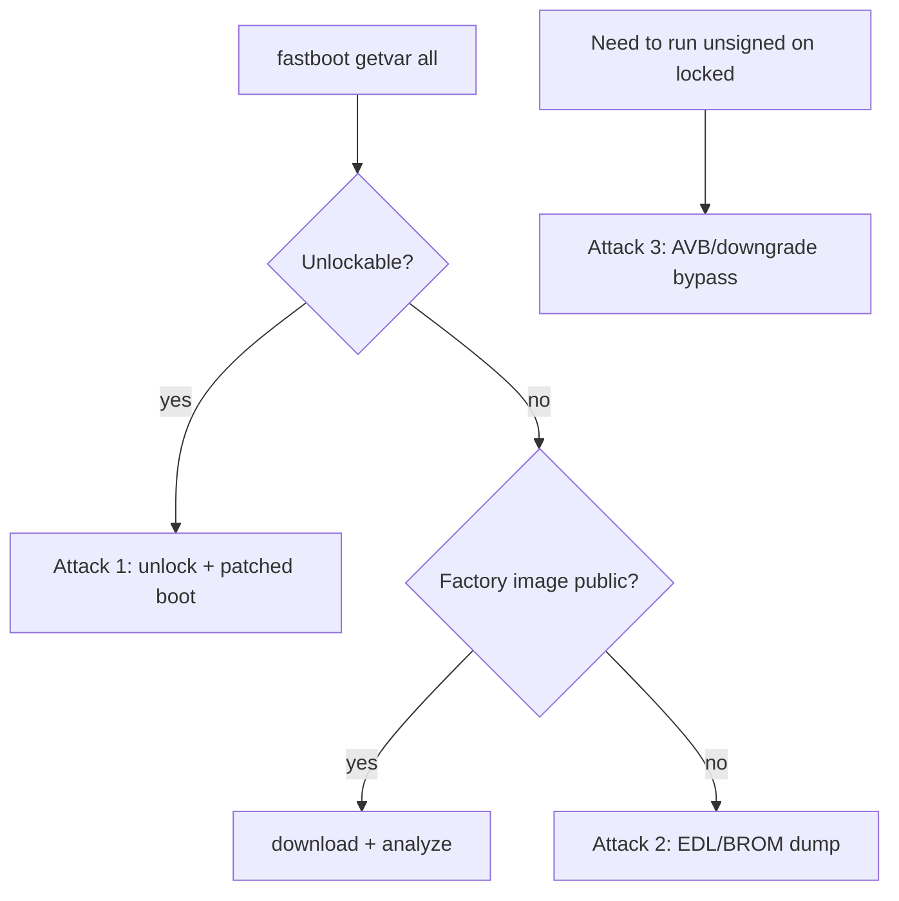

# Android Bootloaders

An Android phone is an ARM SoC running a layered, verified boot chain, with a well-defined low-level interface, **fastboot**, reachable over USB. Understanding the bootloader, how unlocking works, and where firmware lives is the entry point for most phone security work.

!!! warning "Authorized use only"
    For devices you own or are authorized to test.

## The boot chain

```
Boot ROM -> Primary bootloader (SoC, e.g. Qualcomm XBL) -> ABL/aboot (fastboot)
          -> boot/init_boot (kernel + ramdisk) -> system (verified by AVB/dm-verity)
```

Each stage verifies the next, rooted in keys fused into the SoC. **Android Verified Boot (AVB / vbmeta)** and **dm-verity** protect the kernel and system partitions, so modified images are rejected unless the bootloader is unlocked.

## Step 0 — read bootloader state

```bash
fastboot devices
fastboot getvar all           # device, bootloader, unlock state, partitions
fastboot oem device-info      # lock status on many devices
```

Enter fastboot with a key combo or `adb reboot bootloader`. A **locked** bootloader refuses to flash or boot unsigned images — that lock is the main protection.

---

## Attack 1 — unlock + patched-boot root (vendor permits unlock)

**Target:** devices where the vendor allows official unlocking.
**Why it works:** unlocking disables AVB enforcement, so a custom (e.g. Magisk-patched) boot image runs.

Steps:

1. Unlock (wipes user data by design, so it cannot exfiltrate a found phone's data):
   ```bash
   fastboot flashing unlock      # or: fastboot oem unlock
   ```
2. Obtain the stock `boot`/`init_boot` from the factory image, patch it (e.g. Magisk), then:
   ```bash
   fastboot flash boot boot_patched.img
   # or boot it once without flashing:
   fastboot boot boot_patched.img
   ```

**Success condition:** device boots with the patched image and root/instrumentation is available.
**Mitigation:** this is the intended, data-wiping path; it is not a protection bypass.

---

## Attack 2 — dump firmware below a locked bootloader

**Target:** locked devices where fastboot refuses flashing/booting.
**Route:** drop below the bootloader to a [Qualcomm EDL or MediaTek BROM](mobile-soc-edl.md) mode, which can read storage even when fastboot is locked.

Steps:

1. Prefer the **official factory image** if the vendor publishes one — easiest source for [analysis](../attacks/firmware-analysis.md).
2. Else dump via [EDL/BROM](mobile-soc-edl.md) (Attacks 1–2 there).
3. Last resort: [chip-off eMMC/UFS](../attacks/nand-emmc-dump.md).

**Success condition:** partitions imaged. Note userdata is keystore-encrypted — raw access yields ciphertext without the hardware-bound keys.
**Mitigation:** secure the below-bootloader modes; bind encryption to a hardware keystore.

---

## Attack 3 — verified-boot / downgrade bypass (model-specific)

**Target:** a device with a flaw in its boot chain.
**Classes to test:**

- **AVB/vbmeta misconfiguration:** a stage that accepts an unsigned or disabled-verification partition. Covered as [bootloader bypass](../attacks/bootloader-bypass.md).
- **Anti-rollback gaps:** flashing an older *signed* image with a known bug where rollback counters are not enforced.
- **A stage that fails to verify the next**, the classic chain-of-trust break.

These are specific to an exact model/firmware version — enumerate the boot chain, then check published advisories for that device.

**Mitigation:** enforce AVB + rollback protection; verify every stage.

## Decision flow



## Defender's view

Keep the bootloader locked, enforce AVB and rollback protection, bind data encryption to a hardware keystore so storage access alone is useless, and secure the [download modes](mobile-soc-edl.md) below the bootloader. Tie unlocking to a data wipe so it cannot exfiltrate user data.

## Related pages

- [Qualcomm EDL and MediaTek](mobile-soc-edl.md)
- [Chain of Trust and Secure Boot](../attacks/chain-of-trust.md)
- [Bootloader Bypass](../attacks/bootloader-bypass.md)
- [eMMC and SD](../protocols/emmc.md)
- [Firmware Analysis](../attacks/firmware-analysis.md)
