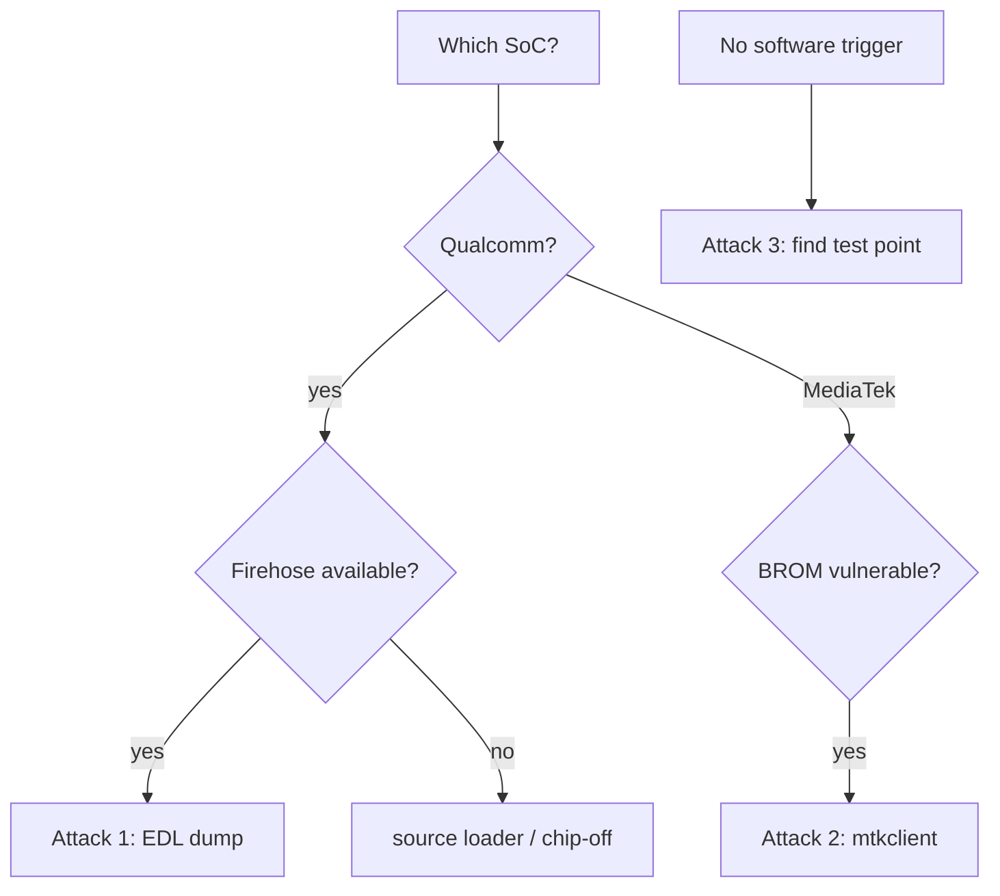

# Qualcomm EDL and MediaTek

Mobile and embedded SoCs keep a low-level **recovery / emergency download mode** in ROM that accepts code and firmware over USB when normal boot fails. On Qualcomm this is **EDL** (Emergency Download, also Sahara/Firehose); on MediaTek it is the **BROM** / Preloader download mode. These modes unbrick and reflash phones at the factory, and they are a powerful, sometimes under-protected entry point.

!!! warning "Authorized use only"
    For devices you own or are authorized to assess.

## Why these modes matter

- They are an [extraction path](../attacks/firmware-extraction.md) that sits **below** the OS and often below the Android bootloader's protections, so they can dump storage even when fastboot is locked.
- They are how bricked devices are revived, so they are intentionally hard to disable.
- Entry often needs only a **test point** on the board shorted to ground at boot — pure hardware recon. See [PCB Recon](../fundamentals/pcb-recon.md).

---

## Attack 1 — Qualcomm EDL storage dump (Sahara + Firehose)

**Target:** Qualcomm devices where a Firehose programmer for the SoC is available.
**Gear:** the open-source [`edl`](https://github.com/bkerler/edl) client (or vendor QFIL), a matching `prog_*_firehose_*.mbn` loader, USB.
**Why it works:** EDL itself only speaks Sahara until the host uploads a small **signed** Firehose programmer; once loaded, the programmer exposes raw read/write of [eMMC/UFS](../protocols/emmc.md), below the Android bootloader's lock.

Steps:

1. **Enter EDL.** `adb reboot edl` if you still have adb, else short the EDL test point to ground at boot, or use a deep-flash/EDL cable. Device enumerates as `05c6:9008`.
2. **Supply the matching Firehose** for the exact SoC (the gating factor — vendor/leaked loaders circulate).
3. **Read the partition table, then dump:**
   ```bash
   edl printgpt                 # read the partition table
   edl r boot boot.img          # read the boot partition
   edl rl dump/ --genxml        # read every partition to dump/
   ```
4. **Analyze** with [binwalk](../software/binwalk.md) / [Ghidra](../reverse-engineering/ghidra-setup.md). Userdata is typically keystore-encrypted, so raw access yields ciphertext without the keys.

**Success condition:** `printgpt` lists partitions and reads succeed.
**Mitigation:** device-bound, authenticated Firehose; no fleet-wide loader reuse.

---

## Attack 2 — MediaTek BROM dump via mtkclient (kamakiri class)

**Target:** MediaTek SoCs vulnerable to the public BROM bypass.
**Gear:** [`mtkclient`](https://github.com/bkerler/mtkclient), USB; a test point or key combo for BROM entry.
**Why it works:** MediaTek's BROM download mode has a widely published authentication bypass ("kamakiri") on many chips, enabling storage read/write and, on affected SoCs, recovery of the hardware-unique storage-encryption keys. Highly chip-and-revision dependent.

Steps:

1. **Enter BROM:** hold the key combo or ground the BROM test point *while* connecting USB, before the Preloader runs (tight timing).
2. **Let mtkclient apply the public bypass and read:**
   ```bash
   mtk printgpt
   mtk r boot boot.bin          # read a partition via BROM
   mtk rl dump/                 # read all partitions
   ```
3. On affected SoCs, mtkclient can also pull the preloader and (where the bug allows) key material for the device's storage crypto.

**Success condition:** BROM handshake completes and partition reads succeed.
**Mitigation:** patched BROM/Preloader (where the SoC allows), authenticated DA, keys not extractable from download mode.

---

## Attack 3 — locate the entry test point (hardware recon)

When there is no software trigger (locked device, no adb), the mode is reached purely physically.

Steps:

1. [PCB recon](../fundamentals/pcb-recon.md): find a lone test pad near the SoC/PMIC, often labeled or community-documented for that model.
2. Short it to ground (or to a specified point) at power-on; confirm the `9008` (Qualcomm) or MediaTek VID/PID enumerates.
3. Proceed with Attack 1 or 2.

**Mitigation:** treat physical access to download pads as realistic; the mode must authenticate, not merely be hidden.

## Decision flow



## Defender's view

Require authenticated, device-bound loaders; do not reuse keys across a fleet; bind storage encryption to keys the download mode cannot extract; patch BROM/Preloader bugs where possible. Physical access to download pads is realistic, so the mode must authenticate.

## Related pages

- [Android Bootloaders](android-bootloader.md)
- [Boot ROM Exploitation](bootrom-exploitation.md)
- [Firmware Extraction](../attacks/firmware-extraction.md)
- [eMMC and SD](../protocols/emmc.md)
- [PCB Recon](../fundamentals/pcb-recon.md)
