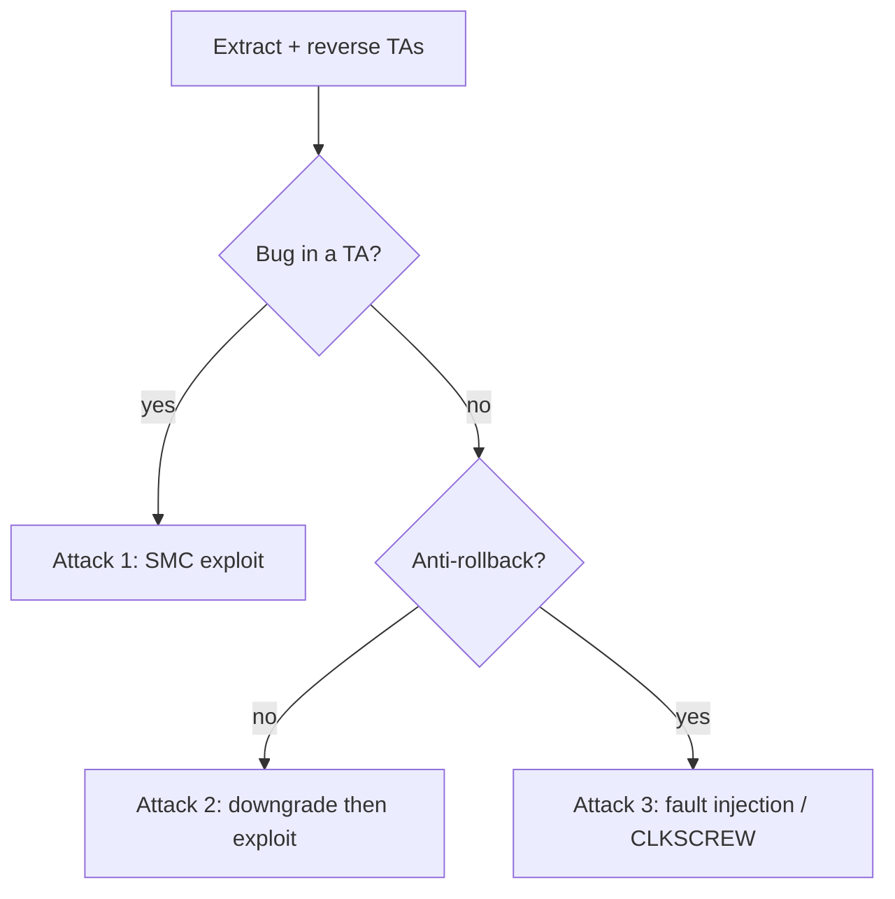

# TEE and TrustZone Exploitation

A Trusted Execution Environment is a hardware-isolated "secure world" running alongside the normal OS on the same application processor: it holds keys, enforces DRM, verifies boot, and runs sensitive services the rich OS cannot touch. On ARM this is **TrustZone**; the secure OS is a vendor TEE (Qualcomm **QSEE/QTEE**, Samsung **TEEGRIS/Kinibi**, Trustonic Kinibi, OP-TEE). Because the TEE is the most privileged software on the chip and runs large, closed codebases, it is a high-value target with a rich exploitation history.

!!! warning "Authorized use only"
    For devices you own or are authorized to assess.

## How the isolation works

ARM TrustZone splits execution into a **secure world** and a **normal world**, tracked by an NS (non-secure) bit propagated through the CPU, memory controller, and peripherals. The normal-world OS calls into the secure world via the **SMC** (Secure Monitor Call) instruction, which traps to a secure monitor that dispatches to **trusted applications (TAs)**. The TEE gatekeeps keys, the fTPM/keystore, DRM (Widevine), and parts of [secure boot](../attacks/chain-of-trust.md).

The attack surface is exactly that boundary: the SMC interface and the TAs that parse normal-world input.

## Step 0 — map the secure surface

Identify the SoC and TEE (Qualcomm→QSEE, Samsung Exynos→TEEGRIS/Kinibi, etc.), then extract the TAs:

- TAs ship in the firmware (often signed blobs: `*.mdt`/`*.b0x` for QSEE, `*.tlbin` for Kinibi). Pull them from a [firmware dump](../attacks/firmware-extraction.md).
- Load into [Ghidra](../reverse-engineering/ghidra-setup.md) (ARM/AArch64); community loaders exist for QSEE and Kinibi TA formats.

---

## Attack 1 — exploit a trusted application over SMC

**Target:** a TA that parses normal-world-supplied buffers.
**Why it works:** TAs are privileged but are often memory-unsafe C parsing attacker-controlled input passed across the SMC boundary; a bug there yields code execution in the secure world.

Steps:

1. Reverse the target TA to find its command handlers and the structure of the buffers the normal world passes.
2. Find a memory-safety bug (unchecked length, type confusion) in a handler.
3. Trigger it from a normal-world client (a kernel module or privileged process issuing the TA's `ioctl`/SMC sequence), gaining execution in the TA → often escalating to the full TEE.

Published results: QSEE TA exploits (Beniamini's work), TEEGRIS/Kinibi TA chains. These frequently escalate from TEE into normal-world kernel too, because the secure world can write normal-world memory.
**Success condition:** controlled code runs in the secure world / secure-world memory is read out.
**Mitigation:** memory-safe TA code, strict buffer validation at the SMC boundary, TA sandboxing.

## Attack 2 — downgrade / rollback a vulnerable TEE image

**Target:** devices without TEE anti-rollback.
**Idea:** flash an older, signed TEE/TA image with a known bug, then run Attack 1 against it. Classic where the boot chain verifies signatures but not version counters — the [bootloader downgrade](../attacks/bootloader-bypass.md) idea applied to the secure world.
**Mitigation:** rollback counters (eFuse-backed) on TEE images.

## Attack 3 — fault-inject the secure monitor / TA check

**Target:** the SMC dispatch or a TA's security decision.
**Idea:** [voltage/EM glitching](../attacks/fault-injection.md) the moment the monitor checks the NS bit or a TA verifies a signature can cross the world boundary or skip a check. **CLKSCREW** did this entirely from software by abusing DVFS to fault TrustZone — see [software-triggered fault injection](../attacks/fault-injection.md#software-triggered-fault-injection-no-bench-rig).
**Mitigation:** redundant checks, glitch detection, locked DVFS limits.

## Decision flow

## Defender's view

Minimize the TA set and the SMC surface, write TAs memory-safely and validate every normal-world buffer, enforce TEE image anti-rollback with eFuse counters, add fault-injection resistance to the secure monitor, and lock the DVFS controls CLKSCREW abuses. Remember the secure world can access normal-world memory, so a TEE compromise is a full-device compromise — keep it small and audited like a [boot ROM](bootrom-exploitation.md).

## Related pages

- [Chain of Trust and Secure Boot](../attacks/chain-of-trust.md)
- [Boot ROM Exploitation](bootrom-exploitation.md)
- [Fault Injection and Glitching](../attacks/fault-injection.md)
- [Secure Elements](../attacks/secure-elements.md)
- [Android Bootloaders](android-bootloader.md)
